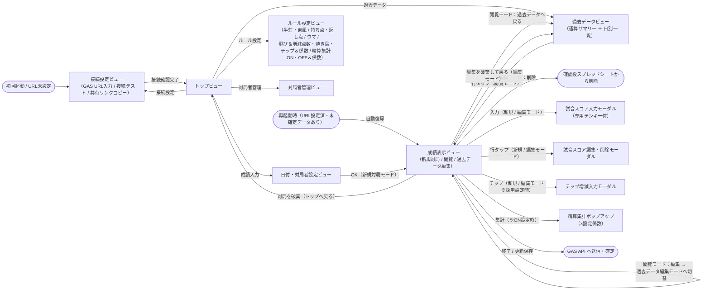

# 麻雀成績管理アプリ 仕様書

## 目次

- [1. 要件定義](#1-要件定義)
  - [1.1 プロジェクト概要](#11-プロジェクト概要)
  - [1.2 システム構成（インフラ・デプロイ）](#12-システム構成インフラデプロイ)
  - [1.3 機能要件一覧](#13-機能要件一覧)
- [2. 外部設計（画面・UI/UX・計算仕様）](#2-外部設計画面uiux計算仕様)
  - [2.1 画面構成（SPAビュー遷移図）](#21-画面構成spaビュー遷移図)
  - [2.2 麻雀ルール・計算ロジック仕様](#22-麻雀ルール計算ロジック仕様)
  - [2.3 画面別UI仕様（iPad mini 6 最適化）](#23-画面別ui仕様ipad-mini-6-最適化)
- [3. 内部設計（データ構造・API設計）](#3-内部設計データ構造api設計)
  - [3.1 Google スプレッドシート データベース設計](#31-google-スプレッドシート-データベース設計)
  - [3.2 GAS Web API インターフェース設計](#32-gas-web-api-インターフェース設計)
  - [3.3 フロントエンド状態管理（接続情報保持・途中保存・リカバリー）](#33-フロントエンド状態管理接続情報保持途中保存リカバリー)
- [4. 将来拡張構想（今後実装を検討する機能）](#4-将来拡張構想今後実装を検討する機能)

---

## 1. 要件定義

### 1.1 プロジェクト概要

- **目的**
  - これまで紙と手計算で行っていた麻雀の成績管理をWebアプリ化し、入力・計算の省力化およびデータの恒久的な蓄積・分析を可能にする。
- **対象端末・環境**
  - iPad mini 6（Safari、ホーム画面追加による全画面表示対応推奨）
  - オンライン環境必須。
- **利用者**
  - 開発者および限定されたメンバー数名。
  - 将来的には不特定多数のユーザーへの公開も視野に入れるが、GASのデプロイ手順を実施できる一定のITリテラシーを有する利用者を想定する。

### 1.2 システム構成（インフラ・デプロイ）

すべて無料で運用可能かつ、不特定多数への公開時も開発者側のサーバー負担・データ管理リスクが発生しない以下の構成を採用する。

- **フロントエンド**
  - HTML / CSS（外部CDN不使用・自前実装） / Vanilla JavaScript（**SPA：1ページ構成**）
  - ホスティング: **GitHub Pages**
  - 外部CSSフレームワークや外部CDNに依存せず、CSS・JSともすべて同一リポジトリ内の静的ファイル（または `index.html` 内包）で完結させることで、外部サービス障害の影響を受けず、ビルド環境不要で運用できる構成とする。
  - 画面遷移を `index.html` 内のビュー切り替えで行うことで、ページ遷移ごとのGAS通信待ち時間をなくす。
  - アプリ本体にはデータや固定のAPI URLを持たせず、利用者ごとに設定画面から接続先（GAS URL）を登録する。
- **バックエンド / データベース**
  - **Google スプレッドシート** ＋ **Google Apps Script (GAS)**
  - 開発者が用意する「**GASコード入りの完成済みテンプレートスプレッドシート**（末尾 `/copy` リンクで配布）」を利用者（またはグループ幹事）が自身のGoogleドライブへコピーし、Webアプリとしてデプロイして使用する。
  - テンプレート側に4つのシートおよび見出し行（`Settings` シートの初期値12行を含む）をあらかじめ定義しておくため、GAS側での初回シート自動生成処理は行わない。

### 1.3 機能要件一覧

本アプリの機能は、「**アプリそのものの基盤・共通機能**」と「**麻雀の対局・スコア管理に関する機能**」に階層を分けて定義する。

#### 1.3.1 アプリ基盤・共通機能（アプリそのものに対する機能）

1. **接続設定・URL共有機能**
   - **目的**
     - アプリ本体にデータや固定サーバーを持たない構成において、利用者ごとに自身のGoogleスプレッドシート（GAS）をデータ保存先として紐づけるために必要。
     - また、iPad Safariの仕様による保存情報消去への備えや、グループメンバー間での接続先共有を容易にするために設ける。
   - **内容**
     - 初回起動時（GAS URL未設定時）およびトップ画面の「接続設定」から、GAS WebアプリURLを入力・保存できる。
     - URL形式チェック（`https://script.google.com/macros/s/.../exec` 形式か検証し、スプレッドシートURLや `/dev` URLの誤入力を案内）および「接続テスト」ボタンを提供する。
     - 設定済みリンク（`?gasUrl=...` 付きURL）のコピーおよび起動時の自動復元ができる。
2. **対局者管理機能**
   - **目的**
     - 対局ごとの名前手入力の手間と表記揺れをなくし、個人別の通算成績を正確に集計・管理するために必要。
     - また、メンバーが抜けた場合でも過去データの表示名が失われないようにするために設ける。
   - **内容**
     - 対局者の新規登録、名前編集、削除（論理削除により過去データへの影響がない形式）ができる。
     - 対局者名の文字数制限は全角8文字（半角16文字）までとし、論理削除済み（`is_active = FALSE`）の対局者と同名での新規登録は許可しない。
     - 名前変更後、過去データビューの列見出しや成績表示ビュー（閲覧モード／過去データ編集モード）には変更後の名前を表示する。
3. **ルール設定永続化・同期機能**
   - **目的**
     - 利用者やグループごとに異なる麻雀ルール・精算係数・表示設定をスプレッドシートへ保存し、端末を跨いだ共有や次回起動時の再設定不要な運用を実現するために必要。
   - **内容**
     - 麻雀に関する各種ルール設定をアプリ上から変更し、Googleスプレッドシート（`Settings` シート）へ保存・読み込みできる。
4. **過去データ閲覧・編集・削除機能**
   - **目的**
     - 蓄積した過去の成績データを年単位や通算で振り返り・分析できるようにするために必要。
     - また、保存完了後に気づいた入力ミスや変更をアプリ上から直接訂正・削除できるようにするために設ける。
   - **内容**
     - 保存された過去の成績を年単位（2026年、2025年…）または「全期間」で絞り込み一覧表示する。
     - 一覧上部に **選択期間内の通算サマリー**（合計ポイント・参加試合数・平均順位）を表示する。
     - 日別成績の行を選択することで「**成績表示ビュー（閲覧モード）**」へ直接遷移し、当時の適用ルールで試合ごとの成績・チップ・精算集計（ON設定時）を確認できる。
     - 閲覧モード上で「**編集**」ボタンを押下すると「**過去データ編集モード**」へ切り替わり、試合スコアおよびチップの追加・編集・削除（上書き保存）や該当対局データの「**削除**」ができる。
5. **途中保存・リカバリー機能**
   - **目的**
     - 対局中の長時間利用において、誤ってSafariのタブを閉じたり再読み込みしたりした際に入力中のスコアが失われる事故を防ぐために必要。
   - **内容**
     - 未確定の対局データ（および過去データ編集モードで編集中のデータ）をブラウザの `localStorage` に自動バックアップし、確定保存完了後にクリアする。

#### 1.3.2 麻雀スコア・対局管理機能（麻雀に関する機能）

1. **麻雀ルール・精算設定機能（Googleスプレッドシート保存）**
   - アプリ使用者が以下の各項目をアプリ上で設定でき、設定結果はGoogleスプレッドシートに保存する。
     - **1試合の形式**
       - `半荘` / `東風` の切り替え設定。
     - **持ち点・返し点**
       - 仕様で定めた固定パターン（`25,000点持ち / 30,000点返し`、`25,000点持ち / 25,000点返し`、`30,000点持ち / 30,000点返し`、`30,000点持ち / 35,000点返し`）からの選択設定。
     - **順位点（ウマ）**
       - 仕様で定めた固定パターン（`なし（0-0）`、`5-15`、`10-20`、`10-30`）からの選択設定。
     - **特殊ルールの採用/不採用**
       - `飛び`、`焼き鳥`、`チップ` それぞれの採用 / 不採用の設定（不採用項目は入力欄・表示列を非表示にする）。
     - **飛びの増減点数設定**
       - 飛び採用時に加算する増減点数を設定可能とする（整数のみ。飛ばされた人はマイナスの整数で初期値 `-5`、飛ばした人はプラスの整数で初期値 `+5`）。
     - **チップ係数設定**
       - チップ採用時に増減枚数1枚あたりへ乗算する **チップ係数の正の整数設定**（初期値：`2`、1以上の整数）。
     - **精算集計ポップアップのON/OFFおよび係数設定**
       - 各対局者の成績に任意の係数を乗算して表示する「集計」ポップアップ機能の有効 / 無効設定と、乗算する **精算係数の正の整数設定**（初期値：`50`）。
   - **対局中のルール変更不可**
     - 対局開始時点（`日付・対局者設定ビュー` 確定時）のルール設定を当該セッションに固定し、対局中（未確定の対局データが存在する状態）のルール変更は行わない。
2. **対局設定機能**
   - 対局日の設定（デフォルトは当日日付）。
   - 参加対局者の選択（4名は必須とし、5名以上も選択可能）。
3. **試合（半荘/東風）スコア入力・計算・修正機能**
   - 試合ごとに参加4名の席順（東南西北）、素点、および設定で有効な特殊要素（飛び・焼き鳥）を入力し、設定されたルールに基づいて自動で最終ポイントを算出する。
   - 素点入力には **専用テンキー**（`+/-` 切替・`00` ボタン付き）および「**4人目自動計算**」ボタンを提供する。
   - 4人の素点合計が基準総点数（`持ち点 × 4`）以外の場合も、確認メッセージで了承すれば登録を許可する（供託リーチ棒残への対応）。
   - 入力済みの試合データは、いつでも再編集・削除ができる。
   - 任意の試合数まで繰り返し追加できる（試合数が多い場合は成績表示画面にて縦スクロール表示）。
   - 参加者が5名以上の場合は全員分の列を表示する（成績表示画面にて横スクロール表示）。
4. **チップ管理・リアルタイム成績・精算集計・確定機能**
   - チップ採用設定時、1日の終了時に増減枚数を入力してポイント換算する（`増減枚数 × チップ係数`、初期係数 `2`、全員の合計が `0` であることを検証）。
   - 現在の「成績（試合合計＋チップ）」をリアルタイムで常時表示する。
   - 精算集計ポップアップ機能がONの場合、「集計」ボタン押下時に各対局者の成績へ設定された精算係数（初期値 `50`）を乗算した精算用数値をポップアップ表示する。
   - 「終了」ボタン押下時、二重送信を防止しつつ1日の成績（適用ルールのスナップショットを含む）および全試合の詳細データをGoogleスプレッドシートへ送信・保存する（なお、参加者に選択されたものの1試合も参加せず、かつチップ増減も0の対局者は `DailyRecords` へ保存しない）。

---

## 2. 外部設計（画面・UI/UX・計算仕様）

### 2.1 画面構成（SPAビュー遷移図）

単一の `index.html` 内で以下のビューおよびモーダルを切り替える。



### 2.2 麻雀ルール・計算ロジック仕様

#### 1. 基本設定（デフォルト値および選択可能な固定パターン）

持ち点・返し点およびウマは、以下の仕様書記載の固定パターンのみを選択可能とする（スプレッドシート上の手動変更等でパターン外の値が取得された場合はデフォルト値へフォールバックする）。

- **1試合の形式**: `半荘`（デフォルト） / `東風`
- **持ち点・返し点（固定パターン）**:

| パターン | 持ち点 | 返し点 | オカ（1位加算） | 備考 |
| :--- | :---: | :---: | :---: | :--- |
| `25000-30000` | 25,000点 | 30,000点 | +20 | デフォルト |
| `25000-25000` | 25,000点 | 25,000点 | 0 | オカなし |
| `30000-30000` | 30,000点 | 30,000点 | 0 | オカなし |
| `30000-35000` | 30,000点 | 35,000点 | +20 | — |

- **ウマ（順位点・固定パターン）**:

| パターン | 1位 | 2位 | 3位 | 4位 | 備考 |
| :--- | :---: | :---: | :---: | :---: | :--- |
| `0-0` | 0 | 0 | 0 | 0 | ウマなし |
| `5-15` | +15 | +5 | -5 | -15 | — |
| `10-20` | +20 | +10 | -10 | -20 | デフォルト |
| `10-30` | +30 | +10 | -10 | -30 | — |

#### 2. 順位決定ルール

- 素点の多い順に1位〜4位を決定する。
- **同点時の処理**: 選択された席順（**東 ＞ 南 ＞ 西 ＞ 北**）に従い、東家に近い方を上位とする。

#### 3. 端数計算とゼロサム調整

- 2位・3位・4位の素点差分 `(素点 - 返し点) / 1000` に対し、JavaScript の `Math.ceil`（＋方向への切り上げ）を適用して整数化する。
- **1位の最終ポイント**: `-(2位の最終ポイント + 3位の最終ポイント + 4位の最終ポイント)` とし、1試合ごとの4人合計が必ず `0` になるよう調整する。

> [!IMPORTANT]
> オカ（`(返し点 - 持ち点) × 4 / 1,000`）は2〜4位の返し点差分を反転するゼロサム計算に自動的に含まれるため、1位へ別途二重加算しないこと。

- **計算例**（デフォルト設定：`25,000点持ち / 30,000点返し / ウマ10-20`、1位 `35,200点`・4人合計 `100,000点` の場合）:

| ケース | 素点 | `(素点 - 30000) / 1000` | `Math.ceil` 適用後 | ウマ加算後の最終pt |
| :--- | :---: | :---: | :---: | :---: |
| ① 返し点より多い（2位） | 32,400点 | +2.4 | +3 | **+13**（+3 + 10） |
| ② 返し点より少ない（4位） | 12,400点 | -17.6 | -17 | **-37**（-17 - 20） |
| ③ ちょうど千点単位（3位） | 20,000点 | -10.0 | -10 | **-20**（-10 - 10） |

- 上記①〜③の例における1位（`35,200点`）の最終ポイント：`-(13 + (-20) + (-37)) = +44`（4人合計：`44 + 13 - 20 - 37 = 0`）

#### 4. 素点合計のチェック（供託残への対応）

- 4人の素点合計が基準総点数（`持ち点 × 4`：例 25,000点持ちなら `100,000点`、30,000点持ちなら `120,000点`）と一致しない場合、入力エラーにせず「全員の点数合計が○○点です。（改行）供託リーチ棒の残と一致する場合はトップ者に自動加算されるため問題ありません。（改行）このまま成績を確定しますか？」という確認ダイアログを表示し、OKなら保存を許可する。
- なお、供託リーチ棒残がある状態でそのまま登録された場合も `2.2-3` のゼロサム調整（`1位 = -(2位 + 3位 + 4位)`）を適用するため、残った供託分は自動的に1位の最終ポイントへ加算される。

#### 5. 特殊要素の計算（ルール設定で採用時のみ有効）

- **飛び（トビ）**:
  - 1試合につき「トビあり／なし」を切り替え、「トビあり」の場合は **飛ばした人**（1名のみ選択）と **飛ばされた人**（1〜3名複数選択可）を指定する（※同一人物を両方に選択することは不可）。
  - 飛ばされた人: 各 設定値（初期値 `-5`、マイナスの整数のみ設定可） / 飛ばした人: `設定値 × 飛ばされた人数`（初期値 `+5`、プラスの整数のみ設定可）
- **焼き鳥（鳥）**:
  - 焼き鳥対象者が合計 `-15` を支払い、焼き鳥ではないプレイヤーが均等に受け取る（割り切れない場合は切り捨て）。
  - ※対象者が2人の場合は、15を2で割り切れないため切り捨てた `7` を採用し、支払・受取ともに各 `7`（合計14）としてゼロサムを保つ。
  - 対象1人（受取3人）: 対象者 `-15` / 受取側 各 `+5`
  - 対象2人（受取2人）: 対象者 各 `-7` / 受取側 各 `+7`
  - 対象3人（受取1人）: 対象者 各 `-5` / 受取側 `+15`
  - 対象0人または4人: 増減 `0`

> [!NOTE]
> ルール設定で「飛び」「焼き鳥」を不採用としている場合は、計算時の加減算を `0` とし、スプレッドシート（`GameDetails`）へは `is_tobi = FALSE`、`tobi_count = 0`、`is_yakitori = FALSE` を保存する。

#### 6. チップ・精算集計計算（各設定が有効時のみ動作）

- **チップ**（採用設定時のみ）
  - 増減枚数（全員の合計が `0` であることをチェック）を入力し、`増減枚数 × 設定されたチップ係数`（初期値 `2`、アプリ上で1以上の整数のみ設定可）をポイントとして加算する。
  - 不採用設定時はチップ加算を `0`（`chip_diff = 0`, `chip_point = 0`）とし、画面上のチップ行・ボタンを非表示とする。
- **精算集計ポップアップ**（ON設定時のみ）
  - `各対局者の成績 × 設定係数`（初期値 `50`、アプリ上で正の整数のみ設定可）を表示する。
  - OFF設定時は「集計」ボタンを非表示とする。

### 2.3 画面別UI仕様（iPad mini 6 最適化）

- **スタイル設計（自前CSS）**
  - 外部CDNを使用しない自前CSSで実装し、`:root` のCSS変数（色・余白・文字サイズ・角丸等のデザイントークン）を一元管理して全画面・モーダル間のデザインを統一する。
  - クラス命名規則を統一してスタイル衝突を防ぎ、テーブル固定表示（`position: sticky`）、専用テンキー（CSS Grid）、iPad画面高さ（`100dvh`）およびセーフエリア（`env(safe-area-inset-*)`）、タッチ操作しやすいタップ領域（44px以上推奨）をCSSで実装する。
- **全画面表示対応**
  - Safariの「ホーム画面に追加」用メタタグを設定し、アドレスバーなしで表示領域を最大化できるようにする。
- **接続設定ビュー**
  - GAS WebアプリURL（例: `https://script.google.com/macros/s/.../exec`）の入力欄を配置する。
  - URL形式のリアルタイム検証および「接続テスト」ボタンを配置し、疎通およびAPIバージョンを確認した上で保存できるようにする。
  - 「設定済みリンクをコピー」ボタンにより、`?gasUrl=...` を付与したブックマーク／グループ共有用URLを取得できる。
  - iPad Safariでは通常ブラウザと「ホーム画面に追加」したアプリで `localStorage` が別領域となり共有されないため、画面上に「`?gasUrl=...` で開いた状態からホーム画面に追加する」運用手順を案内する。
- **ルール設定ビュー**
  - 試合形式（半荘/東風）、持ち点・返し点パターン、順位点（ウマ）パターン、飛び・焼き鳥・チップの採用/不採用トグル、精算集計ポップアップのON/OFFトグル、**飛びの増減点数入力欄**（飛ばされた人：負の整数、初期値 `-5` ／ 飛ばした人：正の整数、初期値 `+5`）、**チップ係数の1以上の整数入力欄**（初期値 `2`、1以上の整数のみ許可）、および **精算係数の正の整数入力欄**（初期値 `50`、正の整数のみ許可）を配置し、「保存」押下でGoogleスプレッドシートへ保存する。
- **試合スコア入力・編集モーダル**
  - モーダル内に **専用テンキー**（`0〜9`、`00`、`+/-` 切替、`1文字削除`、`クリア`）を配置し、iPad標準キーボードによる入力の煩雑さを解消する。
  - 3名分の素点が入力された状態でタップすると、基準総点数（`持ち点 × 4`）との差額を自動セットする「**残り1人を自動計算**」ボタンを配置する。
  - 飛び・焼き鳥の入力欄はルール設定で採用されている項目のみ表示する。
  - 「登録」（または「更新」）ボタン押下時、入力内容を1位〜4位の順で並べ替え、順位・方角・対局者名・素点・飛び・焼き鳥・算出ポイントを一覧表示する **入力内容確認ビュー** へ切り替える。内容確認後に「確定して登録（更新）」で確定し、「戻って修正」で入力画面へ戻れる。
- **成績表示ビュー**
  - 現在の試合形式ラベル（半荘第N戦 / 東風第N戦 ※`N` は入力済みの試合数、0試合時は第0戦）を表示する。
  - 左端の見出し列（試合番号列）は固定幅かつ中央揃えとし、対局者列は画面幅から見出し列を除いた残余幅を自動計算で4等分した幅とすることで、見出し列＋4人分を1画面内に収める（5名以上の場合は同幅のまま人数分の列を配置し、横スクロール可能とする）。
  - 試合数が多い場合はテーブルボディを縦スクロール可能とし、ヘッダー（対局者名）およびフッター（チップ行・成績行）を常時画面内に固定表示する（チップ不採用時はチップ行を非表示）。
  - 抜け番のプレイヤーのセルは「ー」とし、成績行には参加した試合分のみを合算する。
  - 飛ばした人は緑色の「飛」、飛ばされた人は赤色の「飛」、焼き鳥は赤色の「鳥」として表示する。
  - 以下の 3 つのモードで動作し、モードに応じて表示ボタン・操作可否を切り替える。
    - **新規対局モード**: `入力`、`チップ`（採用設定時のみ）、`集計`（ON設定時のみ）、`終了`、`対局を破棄（トップへ戻る）` を表示する（破棄時は確認ダイアログで了承後、`localStorage` の未確定データを破棄してトップビューへ戻る）。
    - **閲覧モード**（過去データビューで行タップ時に遷移）: 当該対局の適用ルール（`rule_snapshot`、未記録時は現行 `Settings` 設定）を復元して表示する。**成績の編集に関わるボタン（`入力`、`チップ`、`終了`/`更新保存`、`破棄`、`削除`）はすべて非表示**とし、試合行タップによる編集モーダル起動も無効とする（精算集計ON設定時は参照用の `集計` ボタンを表示し、上部に「過去データへ戻る」ボタンを配置する）。下部に **「編集」** ボタンを表示し、押下すると **過去データ編集モード** へ切り替わる。
    - **過去データ編集モード**: **試合スコアおよびチップの追加・編集・削除のみ**を可能とする（対局日・参加対局者・適用ルールの変更は不可）。試合行タップ編集、`入力`、`チップ`（採用設定時のみ）、`集計`（ON設定時のみ）、`更新保存`、`編集を破棄して戻る`（確認後、変更を保存せず編集用一時データを破棄して過去データビューへ戻る）、および **「削除」** ボタン（確認後 `deleteSession` を実行して該当対局を削除し、過去データビューへ戻る）を表示する。
- **過去データビュー**
  - 左端の日付列（見出し列）は固定幅で固定し、**有効な対局者（`is_active = TRUE`）全員および選択期間内に成績データが存在する論理削除済み対局者（`is_active = FALSE`）**の列を配置する。各対局者列は画面幅から見出し列を除いた残余幅を4等分した幅（4人以下時は均等割り、5人以上時は4人分を1画面内に表示して横スクロール）とし、列見出しおよび成績表示ビュー等の表示名には `Players` マスタの現行名を使用する。
  - 一覧の行は日付（`date`）ではなく `session_id` 単位で表示する（同日に複数回「終了」保存された場合は、同じ日付の行が複数表示される）。
  - 試合行をタップすると、当該対局のデータを読み込んだ **成績表示ビュー（閲覧モード）** へ遷移する。
  - テーブル最上部に選択期間内の **通算サマリー行**（合計ポイント・参加試合数・平均順位）を固定表示する。
  - 「期間」ボタン押下時、データが存在する年（2026年、2025年…）および「全期間」を選択できるモーダルを表示する。

---

## 3. 内部設計（データ構造・API設計）

### 3.1 Google スプレッドシート データベース設計

テンプレートとなるスプレッドシートにあらかじめ以下の4つのシート（テーブル）および1行目のカラム見出し（`Settings` シートは初期値12行を含む）を作成しておく。

#### ① `Players` シート（対局者マスタ）

| カラム名 | 型 | 説明 |
| :--- | :--- | :--- |
| `player_id` | String | 一意のID（例: `P001`） |
| `name` | String | 一意の対局者名（最大で全角8文字／半角16文字。論理削除済み `is_active = FALSE` と同名の登録も不可） |
| `is_active` | Boolean | 有効フラグ（削除時は `FALSE` にし、過去データの表示名は維持する） |
| `created_at` | DateTime | 登録日時 |

#### ② `DailyRecords` シート（日別最終成績・分析用）

※同日に複数回セッションを終了した場合は、`session_id` ごとに別セッションとして記録する。また、`game_count = 0` かつ `chip_diff = 0` の対局者は保存対象から除外する。

| カラム名 | 型 | 説明 |
| :--- | :--- | :--- |
| `session_id` | String | 対局日セッションID（UUID等） |
| `date` | String | 対局日（`YYYY/MM/DD` 形式の文字列として保存） |
| `player_id` | String | 対局者ID |
| `player_name` | String | 対局者名（保存時スナップショット ※画面表示では `player_id` に紐づく `Players` の現行名を使用） |
| `game_count` | Number | 当日の参加試合数 |
| `chip_diff` | Number | チップ増減枚数（不採用時は `0`） |
| `chip_point` | Number | チップポイント（`chip_diff × チップ係数`、不採用時は `0`） |
| `total_point` | Number | 当日最終成績（試合合計 ＋ チップポイント） |
| `rule_snapshot` | String | 当日適用したルール設定のJSONスナップショット（過去データ閲覧・編集時のルール再現用） |

#### ③ `GameDetails` シート（試合別詳細ログ）

| カラム名 | 型 | 説明 |
| :--- | :--- | :--- |
| `session_id` | String | `DailyRecords` と紐づくセッションID |
| `date` | String | 対局日（`YYYY/MM/DD` 形式の文字列として保存） |
| `game_number` | Number | 試合番号（1, 2, 3...） |
| `player_id` | String | 対局者ID |
| `player_name` | String | 対局者名（保存時スナップショット ※画面表示では `player_id` に紐づく `Players` の現行名を使用） |
| `wind` | String | 席順（`東`, `南`, `西`, `北`） |
| `raw_score` | Number | 素点（例: `35400`） |
| `rank` | Number | 順位（1〜4） |
| `is_tobi` | Boolean | 飛ばされたフラグ（不採用時は `FALSE`） |
| `tobi_count` | Number | 飛ばした人数（不採用時は `0`） |
| `is_yakitori` | Boolean | 焼き鳥フラグ（不採用時は `FALSE`） |
| `final_point` | Number | 試合最終ポイント |

#### ④ `Settings` シート（ルール・アプリ設定マスタ）

Key-Value形式で保持し、将来の設定項目追加にも柔軟に対応できる構成とする。テンプレートには初期値12行を入れておくが、万が一空・一部キー欠損・または固定パターン外／不正値が入っている場合はアプリ側でデフォルト値をフォールバック適用する。

| カラム名 | 型 | 説明 |
| :--- | :--- | :--- |
| `setting_key` | String | 設定キー |
| `setting_value` | String | 設定値 |
| `updated_at` | DateTime | 最終更新日時 |

**テンプレート初期値12行一覧**

| 行 | `setting_key` | `setting_value`（初期値） | `updated_at` | 設定可能な値・備考 |
| :-: | :--- | :--- | :--- | :--- |
| 1 | `game_type` | `hanchan` | 作成日時 | `hanchan` / `tonpuu` |
| 2 | `starting_points` | `25000` | 作成日時 | `25000` / `30000` |
| 3 | `return_points` | `30000` | 作成日時 | `25000` / `30000` / `35000`（※2.2節の4パターンに準拠） |
| 4 | `uma_pattern` | `10-20` | 作成日時 | `0-0` / `5-15` / `10-20` / `10-30` |
| 5 | `use_tobi` | `true` | 作成日時 | `true` / `false` |
| 6 | `tobi_busted_point` | `-5` | 作成日時 | `-1` 以下の負の整数文字列（例: `"-5"`） |
| 7 | `tobi_flyer_point` | `5` | 作成日時 | `1` 以上の正の整数文字列（例: `"5"`） |
| 8 | `use_yakitori` | `true` | 作成日時 | `true` / `false` |
| 9 | `use_chip` | `true` | 作成日時 | `true` / `false` |
| 10 | `chip_rate` | `2` | 作成日時 | 1以上の正の整数文字列（例: `"2"`） |
| 11 | `use_settlement` | `true` | 作成日時 | `true` / `false` |
| 12 | `settlement_rate` | `50` | 作成日時 | 正の整数文字列（例: `"50"`） |

### 3.2 GAS Web API インターフェース設計

- **エンドポイント**
  - 利用者が接続設定画面で入力・保存したGAS Webアプリの公開URL（`https://script.google.com/macros/s/.../exec`）。
- **通信仕様（CORS対策）**
  - GASがブラウザのプリフライトリクエスト（`OPTIONS`）に対応していないため、すべてのAPI通信を `POST` メソッド ＋ `Content-Type: text/plain`（ボディにJSON文字列）に統一する。
- **JSONキー命名規則**
  - レコード項目およびコレクションのキー名はスプレッドシートのカラム名・テーブル名と一致する **`snake_case`**（`player_id`, `daily_records`, `game_details` 等）に統一し、フロントエンドとGAS間の変換ミスを防ぐ（API制御用キー `action`, `status`, `apiVersion`, `message` のみ例外とする）。
- **アクセス制御方針**
  - 初期リリースでは限定メンバー間での利用を前提とし、パスコード認証は設けない（公開URLを知っているメンバーのみが利用する運用とし、共有URLを外部の公開場へ掲載しないことで安全性を担保する）。
- **APIバージョン互換性チェック**
  - レスポンスJSONに `apiVersion`（例: `"1.0"`）を含め、フロントエンド側でアプリが要求するバージョンとの互換性を確認する。
  - 不整合時はGASコード更新を促す案内を表示する。
- **排他制御・重複ガード**
  - 書き込み系APIでは GAS の `LockService.getScriptLock()` を使用し、同時実行や二重送信によるデータ破損を防ぐ。
- **日付データのタイムゾーン対策**
  - スプレッドシート上の日付セルの型変換やタイムゾーン差による1日ずれを防ぐため、書き込み・読み出し処理を以下の方式に統一する。
  - **書き込み時（`saveSession` / `updateSession`）**: 対象の日付セルに文字列書式（`setNumberFormat("@")`）を設定した上で、`YYYY/MM/DD` 形式の文字列として保存する。
  - **読み出し時（`getInitialData`）**: 手動編集等により `Date` 型となっているセルにも対応できるよう、`val instanceof Date ? Utilities.formatDate(val, ss.getSpreadsheetTimeZone(), "yyyy/MM/dd") : String(val)`（`ss = SpreadsheetApp.getActiveSpreadsheet()`）の判定処理に一本化し、必ずタイムゾーンずれのない `YYYY/MM/DD` 文字列として返却する。
- **主なAPIアクション（`action` パラメータ）**および入出力JSONサンプル
  - **共通エラーレスポンス**（全アクション共通）
    ```json
    {
      "status": "error",
      "apiVersion": "1.0",
      "message": "エラー内容の説明"
    }
    ```
  - **`testConnection`**（疎通確認および `apiVersion` 返却）
    - Request:
      ```json
      {
        "action": "testConnection"
      }
      ```
    - Response:
      ```json
      {
        "status": "ok",
        "apiVersion": "1.0"
      }
      ```
  - **`getInitialData`**（`Players`、`DailyRecords`、`GameDetails`、`Settings` を一括取得 ※`Settings` 欠損時はデフォルト値で補完）
    - Request:
      ```json
      {
        "action": "getInitialData"
      }
      ```
    - Response:
      ```json
      {
        "status": "ok",
        "apiVersion": "1.0",
        "players": [
          {
            "player_id": "P001",
            "name": "Aさん",
            "is_active": true,
            "created_at": "2026/11/16 20:00:00"
          }
        ],
        "daily_records": [
          {
            "session_id": "550e8400-e29b-41d4-a716-446655440000",
            "date": "2026/11/16",
            "player_id": "P001",
            "player_name": "Aさん",
            "game_count": 3,
            "chip_diff": 2,
            "chip_point": 4,
            "total_point": 48,
            "rule_snapshot": "{\"game_type\":\"hanchan\",\"starting_points\":\"25000\",\"return_points\":\"30000\",\"uma_pattern\":\"10-20\",\"use_tobi\":\"true\",\"tobi_busted_point\":\"-5\",\"tobi_flyer_point\":\"5\",\"use_yakitori\":\"true\",\"use_chip\":\"true\",\"chip_rate\":\"2\",\"use_settlement\":\"true\",\"settlement_rate\":\"50\"}"
          }
        ],
        "game_details": [
          {
            "session_id": "550e8400-e29b-41d4-a716-446655440000",
            "date": "2026/11/16",
            "game_number": 1,
            "player_id": "P001",
            "player_name": "Aさん",
            "wind": "東",
            "raw_score": 35200,
            "rank": 1,
            "is_tobi": false,
            "tobi_count": 0,
            "is_yakitori": false,
            "final_point": 44
          }
        ],
        "settings": [
          {
            "setting_key": "game_type",
            "setting_value": "hanchan",
            "updated_at": "2026/11/16 20:00:00"
          }
        ]
      }
      ```
  - **`saveSettings`**（`Settings` シートの更新・保存）
    - Request:
      ```json
      {
        "action": "saveSettings",
        "settings": [
          { "setting_key": "game_type", "setting_value": "hanchan" },
          { "setting_key": "starting_points", "setting_value": "25000" },
          { "setting_key": "return_points", "setting_value": "30000" },
          { "setting_key": "uma_pattern", "setting_value": "10-20" },
          { "setting_key": "use_tobi", "setting_value": "true" },
          { "setting_key": "tobi_busted_point", "setting_value": "-5" },
          { "setting_key": "tobi_flyer_point", "setting_value": "5" },
          { "setting_key": "use_yakitori", "setting_value": "true" },
          { "setting_key": "use_chip", "setting_value": "true" },
          { "setting_key": "chip_rate", "setting_value": "2" },
          { "setting_key": "use_settlement", "setting_value": "true" },
          { "setting_key": "settlement_rate", "setting_value": "50" }
        ]
      }
      ```
    - Response:
      ```json
      {
        "status": "ok",
        "apiVersion": "1.0",
        "settings": [
          {
            "setting_key": "game_type",
            "setting_value": "hanchan",
            "updated_at": "2026/11/16 21:00:00"
          }
        ]
      }
      ```
  - **`savePlayers`**（対局者マスタの追加・更新・論理削除 ※新規追加時は `player_id` を空文字とし、`LockService` 配下のGAS側で `P001`〜 を採番）
    - Request:
      ```json
      {
        "action": "savePlayers",
        "players": [
          { "player_id": "", "name": "Eさん", "is_active": true },
          { "player_id": "P001", "name": "Aさん改", "is_active": true },
          { "player_id": "P002", "name": "Bさん", "is_active": false }
        ]
      }
      ```
    - Response:
      ```json
      {
        "status": "ok",
        "apiVersion": "1.0",
        "players": [
          {
            "player_id": "P001",
            "name": "Aさん改",
            "is_active": true,
            "created_at": "2026/11/16 20:00:00"
          },
          {
            "player_id": "P002",
            "name": "Bさん",
            "is_active": false,
            "created_at": "2026/11/16 20:00:00"
          },
          {
            "player_id": "P005",
            "name": "Eさん",
            "is_active": true,
            "created_at": "2026/11/16 21:05:00"
          }
        ]
      }
      ```
  - **`saveSession`**（新規対局終了時の一括追記 ※同一 `session_id` 存在時はスキップ、`game_count = 0` かつ `chip_diff = 0` の対局者は `DailyRecords` へ保存しない）
    - Request:
      ```json
      {
        "action": "saveSession",
        "session_id": "550e8400-e29b-41d4-a716-446655440000",
        "daily_records": [
          {
            "session_id": "550e8400-e29b-41d4-a716-446655440000",
            "date": "2026/11/16",
            "player_id": "P001",
            "player_name": "Aさん",
            "game_count": 3,
            "chip_diff": 2,
            "chip_point": 4,
            "total_point": 48,
            "rule_snapshot": "{\"game_type\":\"hanchan\",\"starting_points\":\"25000\",\"return_points\":\"30000\",\"uma_pattern\":\"10-20\",\"use_tobi\":\"true\",\"tobi_busted_point\":\"-5\",\"tobi_flyer_point\":\"5\",\"use_yakitori\":\"true\",\"use_chip\":\"true\",\"chip_rate\":\"2\",\"use_settlement\":\"true\",\"settlement_rate\":\"50\"}"
          }
        ],
        "game_details": [
          {
            "session_id": "550e8400-e29b-41d4-a716-446655440000",
            "date": "2026/11/16",
            "game_number": 1,
            "player_id": "P001",
            "player_name": "Aさん",
            "wind": "東",
            "raw_score": 35200,
            "rank": 1,
            "is_tobi": false,
            "tobi_count": 0,
            "is_yakitori": false,
            "final_point": 44
          }
        ]
      }
      ```
    - Response:
      ```json
      {
        "status": "ok",
        "apiVersion": "1.0",
        "skipped": false
      }
      ```
  - **`updateSession`**（過去データ編集時に指定 `session_id` の既存行を削除した上で最新データを再書き込み ※`game_count = 0` かつ `chip_diff = 0` の対局者は `DailyRecords` へ保存しない）
    - Request: `action` を `"updateSession"` とする以外は `saveSession` と同一形式。
    - Response:
      ```json
      {
        "status": "ok",
        "apiVersion": "1.0"
      }
      ```
  - **`deleteSession`**（指定 `session_id` に該当する `DailyRecords` と `GameDetails` の行を削除）
    - Request:
      ```json
      {
        "action": "deleteSession",
        "session_id": "550e8400-e29b-41d4-a716-446655440000"
      }
      ```
    - Response:
      ```json
      {
        "status": "ok",
        "apiVersion": "1.0"
      }
      ```

### 3.3 フロントエンド状態管理（接続情報保持・途中保存・リカバリー）

- 接続設定（`gasUrl`）および新規対局中の未確定データ（**対局開始時に確定したルールスナップショットを含む**）はブラウザの `localStorage` に保存する。
- 未確定の新規対局データが `localStorage` に残っている状態でアプリを再起動・再読み込みした場合は、自動で `成績表示ビュー` へ復帰し、開始時のルールスナップショットのまま対局を継続する（対局中のルール変更は不可）。
- **iPad Safari（ITP）対策**
  - 7日間アクセスがない場合に `localStorage` が消去される挙動に備え、URLクエリパラメータ（`?gasUrl=...`）付きの起動で接続先URLを自動復元できるようにする（再入力不要で自動復帰可能）。
  - すでに別の `gasUrl` が保存されている状態で異なる `?gasUrl=...` 付きURLを開いた場合も、警告・確認ダイアログは表示せずそのまま新しい `gasUrl` で自動上書きし、旧接続先で入力中だった未確定データ（一時バックアップ）は自動削除する。
  - また、通常Safariとホーム画面追加アプリ間で `localStorage` が分離される仕様を踏まえ、`?gasUrl=...` で開いた状態からホーム画面へ追加するよう運用案内を行う。
- 「終了」ボタン押下後、GAS APIへの保存が正常完了したタイミングで対局中の一時データをクリアする。
- 過去データの **閲覧モード** では `localStorage` へ一時保存せず、「編集」ボタン押下によって **過去データ編集モード** へ切り替わった時点から一時バックアップを新規対局用と分離して保持し、新規対局の入力中データが上書きされないようにする。また、過去データ編集モードでは試合スコアおよびチップの追加・編集・削除のみを許可し、対局日・参加対局者・適用ルールの変更は行わない（編集途中でルール設定ビューから設定を変更しても、編集中の過去データには影響せず当時の `rule_snapshot` を維持する。「編集を破棄して戻る」時は、編集用一時データのみ破棄して過去データ自体は変更せず過去データビューへ戻る）。
- 確定済みの過去成績には計算結果（`final_point`, `total_point`）および当時のルール（`rule_snapshot`）が保存されているため、後から `Settings` のルールを変更しても過去日の成績値が遡って書き換わることはなく、過去データ閲覧・編集時も当時のルールのまま安全に参照・再計算・修正できる（`rule_snapshot` が未記録のレコードは現在の `Settings` 設定を適用）。

---

## 4. 将来拡張構想（今後実装を検討する機能）

初期リリースでは実装を見送り、今後のアップデート候補として以下の構想を保持する。

- **お試し（ローカル保存）モード**:
  - 初見ユーザーがGAS URLの初期設定を行わなくても、ブラウザ内の `localStorage` のみを使用してスコア入力・計算・成績管理を試用できるモード。
  - 試用後に気に入った場合、設定画面からGAS URLを登録することで、そのままスプレッドシート管理へ移行（データ引き継ぎ）できる仕組みを将来的な拡張として検討する。
- **不特定多数にアプリを公開する場合に考慮すべき点（認証・アクセス制御の強化）**:
  - 初期リリースでは限定メンバー間の運用を前提としてパスコード認証を廃止しているが、不特定多数のユーザーへ公開する場合は以下の対策を検討する。
  - **共有URL流出時のデータ保護**: 利用者が誤って `?gasUrl=...` 付きURLをSNS等の公開の場へ共有した場合、認証がない状態では第三者でもAPI経由でデータの閲覧・改ざん・削除が可能となる。これを防ぐため、APIリクエスト時のパスコード検証（`/copy` テンプレート配布時の手軽さを損なわないよう、`Settings` シート等で任意設定でき、未設定時はスキップできる方式等）の導入を検討する。
  - **個別ユーザーのアクセス遮断**: パスコードなしの構成では元メンバー等のアクセスを止める際にGASの再デプロイ（URL変更と全員への再共有）が必要となるため、認証コード変更のみで既存URLからのアクセスを遮断できる仕組みの導入を検討する。
- **3麻（3人打ち）の実装**:
  - 各計算式やバリデーションで人数を `4` としている箇所（基準総点数 `持ち点 × N`、1試合の対局者数 `N` 名、席順、1位のゼロサム調整 `-(2位 + ... + N位)` 等）を人数変数 `N` として抽象化し、ルール設定ビューにて「4麻（4人打ち）」と「3麻（3人打ち）」を切り替えられるようにする。
  - **実装時の主な留意事項**:
    - **持ち点・返し点およびウマパターンの拡張**: 3麻では `35,000点持ち / 40,000点返し` 等が一般的であり、ウマも3人分（例：`0-10`、`10-20` や、2位の浮き沈みで変動する沈みウマへの対応要否）が必要となるため、4麻用とは別の固定パターン定義（または人数に応じた選択肢の出し分け）を設ける必要がある。
    - **席順・特殊ルール計算の分岐**:
      - 席順は `東・南・西` の3席のみとし、スコア入力モーダル上の北家枠を非表示にする（同点時判定も `東 ＞ 南 ＞ 西`）。
      - 飛び（トビ）の「飛んだ人」の選択上限を `1〜2名`（4麻時は `1〜3名`）へ変更する。
      - 焼き鳥は現行が4人前提の配分（`-15 / +5`、`-7 / +7`、`-5 / +15`）となっているため、3人打ち用の配分ロジック（0人・3人時は増減 `0`、1人・2人時の支払／受取額と端数処理）を別途定義する必要がある。
    - **UI・入力制御の調整**: 日付・対局者設定ビューでの参加必須人数を「3名以上」へ緩和し、試合スコア入力モーダルの「残り1人を自動計算」は `N - 1` 名（3麻時は2名）入力済みで動作するよう調整する。また、成績表示ビューの列幅計算（見出し列＋4人分の4等分設計）について、3名時は3等分とするか4等分幅のまま表示するかの方針統一が必要となる。
    - **4麻・3麻混在時の過去データ集計とスナップショット互換性**: 同一スプレッドシート上で4麻と3麻を併用すると「平均順位」の母数（4位あり vs 3位まで）が混在するため、過去データビューで4麻/3麻ごとの絞り込みフィルタを設けるか、運用上スプレッドシートを分けるかの方針検討が必要になる。あわせて、既存の4麻過去データ（人数設定キー未記録の `rule_snapshot`）は常に4麻として復元する後方互換性対応が必須となる。
